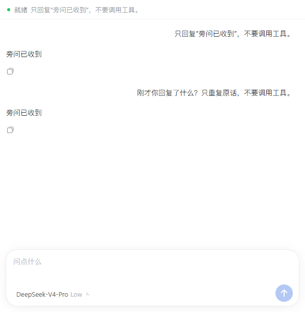
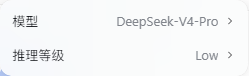

# DSH Side Codex · 旁问

[English](README_EN.md)

在 DeepSeek Harness 的原生右侧栏里，围绕主对话顺便提问。旁问继承主对话上下文，拥有独立的消息、模型和推理等级。

本项目基于 [zclDragon/dsh-side-chat](https://github.com/zclDragon/dsh-side-chat) 的 MIT 许可代码继续开发，保留原作者署名。交互参考 Codex，界面沿用 DSH 自身的组件、字体和主题；与 OpenAI、DeepSeek 无隶属关系。

## 功能

- 原生右侧栏，通过侧栏入口、`/side` 或 `/btw` 打开。
- 创建旁问时继承主对话历史；主任务进行中也能从已接纳的问题、已完成步骤处分支。
- 选中主对话文字，点击悬浮按钮「发送到旁问」，生成可移除的引用气泡；补充问题后再发送。
- 使用 DSH 原生发送、停止、复制交互，流式显示回答及模型实际返回的思考过程。
- 输入框底部复用 DSH 原生模型菜单，默认继承主对话的模型与推理等级，也能单独切换。
- 切换模型保留旁问历史；停止旁问只停止当前旁问。

## 预览





## 安装

已在 **DSH Desktop 0.2.1-rc.5**（Windows）验证。当前声明的宿主范围为 `>=0.2.1-rc.5 <0.2.2-0`；后续版本需验证后再扩大兼容范围。

下载 [最新 Release](https://github.com/channel-c/dsh-side-codex/releases/latest) 的预构建安装包。在 DSH Desktop 的插件管理中，通过「从 URL 安装」或添加插件源输入：

```text
https://github.com/channel-c/dsh-side-codex/releases/latest/download/dsh-side-codex.tgz
```

从终端启动的 DSH Web 可执行：

```sh
dsh plugin --profile web add https://github.com/channel-c/dsh-side-codex/releases/latest/download/dsh-side-codex.tgz
```

也可以从带有预构建 `lib/` 的 GitHub 仓库安装：

```sh
dsh plugin --profile web add github:channel-c/dsh-side-codex#main
```

安装到实际使用的 profile，按宿主提示重新加载。Desktop 与 CLI 的 `web` profile 不是同一配置。

请只启用本插件的一个版本。它与原版 `@zhuchenglong/dsh-side-chat`、早期 `dsh-side-codex-dbg*` 版本共享命令和路由，不能同时启用。

## 使用

1. 打开已有主对话，在右侧栏选择「侧边对话」，或输入 `/side`。
2. 输入问题，按 Enter 发送；Shift+Enter 换行。也可先选中文字，再点击「发送到旁问」。
3. 在输入框底部点击模型名称，选择旁问的模型和推理等级。尚未创建旁问时显示「继承主对话」，点击后创建独立会话并展开菜单，创建本身不发起模型请求。
4. 生成时可停止，思考过程可展开。通过侧栏标签的关闭按钮结束当前旁问。

`/side 你的问题` 与 `/btw 你的问题` 会直接把问题发到旁问。

## 上下文与隔离

- **上下文是创建时的快照。** 已有旁问不会自动同步主对话后续的新消息；可以继续引用主对话中的新选区，或关闭当前旁问后重新开启。
- 继承的是 DSH 当前提供给模型的历史。若主对话已经压缩，旁问也受相同压缩与上下文窗口限制。
- 旁问的回答和停止操作不写回、不取消主任务。两边共用工作目录；如果明确要求旁问编辑文件，文件改动仍对主任务可见。
- 旁问将继承历史视为背景，不自动续做父任务、父任务排队消息或未完成工具调用。这是提示策略，不是文件系统沙箱。
- 缓存由所选模型服务和 DSH 适配器处理。继承上下文不保证缓存命中；换模型或供应商可能降低复用。新的回答仍需生成并计费。
- 旁问的活动分组保存在当前进程中，重启后不会恢复为活动面板。关闭时释放 agent，并通过宿主归档会话；本插件不删除 DSH 的持久会话日志。

## 开发

使用 Node.js 24：

```sh
npm ci
npm run check
npm pack
```

预构建 `lib/` 随仓库和 Release 一起提供，安装时无需执行构建脚本。源码、回归测试及构建脚本均包含在仓库中。

实现说明见 [架构](docs/architecture.md)，版本变化见 [CHANGELOG](CHANGELOG.md)。遇到问题请提交 [Issue](https://github.com/channel-c/dsh-side-codex/issues)，附 DSH 版本和复现步骤，先移除日志中的凭据与私人对话。

## 许可与来源

MIT，见 [LICENSE](LICENSE)。上游：[zclDragon/dsh-side-chat](https://github.com/zclDragon/dsh-side-chat)。本 fork 增加原生侧栏、选区引用、思考过程显示、独立模型选择，并修复启动兼容性与父任务排队消息串入旁问的问题。
