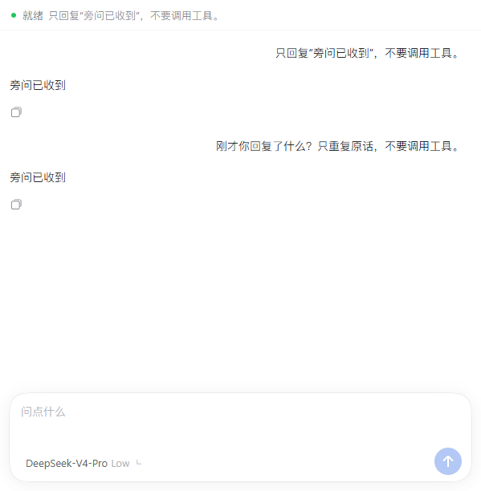
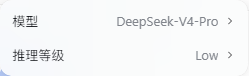

# DSH Side Ask

[中文](README.md)

A native DSH sidebar for independent side questions with inherited conversation context, quoted selections, streamed reasoning, and per-side-chat model selection.

This is an MIT-licensed fork of [zclDragon/dsh-side-chat](https://github.com/zclDragon/dsh-side-chat). It uses DSH's components, typography and theme. It is not affiliated with OpenAI or DeepSeek.

## Features

- Open the native right sidebar, `/side`, or `/btw`.
- Inherit an accepted main-chat question or completed step, including while the main task runs.
- Select main-chat text and choose **发送到旁问**. A removable quote appears in the composer; add your question before sending.
- Stream answers and actual provider-returned reasoning, with native DSH send/stop/copy controls.
- Use DSH's native model and reasoning-effort menu independently in each side chat. The initial selection is inherited from the parent, including a model change that has not been used in a request yet.
- Keep side-chat history when switching models. Stopping a side chat does not stop its parent.

## Preview





## Install

Tested on **DSH Desktop 0.2.1-rc.5**, Windows. Declared host range: `>=0.2.1-rc.5 <0.2.2-0`. Later host versions require validation before broadening this range.

In DSH Desktop, install the prebuilt package URL through the plugin manager:

```text
https://github.com/channel-c/dsh-side-ask/releases/latest/download/dsh-side-ask.tgz
```

For a CLI-managed Web profile:

```sh
dsh plugin --profile web add https://github.com/channel-c/dsh-side-ask/releases/latest/download/dsh-side-ask.tgz
```

The repository also includes built `lib/` files:

```sh
dsh plugin --profile web add github:channel-c/dsh-side-ask#main
```

Install into the profile you actually use, then reload as directed by your host. The Desktop and CLI `web` profiles are separate.

Enable only one version. This fork shares commands and routes with the original `@zhuchenglong/dsh-side-chat` and earlier debug builds; do not enable them together.

## Usage

Open a main conversation, select the side-chat tab, and ask a question. Enter sends; Shift+Enter adds a newline. The initial model entry reads **继承主对话**; clicking it creates a child session and opens the native menu, without making a model request. Change the model or reasoning effort there. Use the native tab close button to close the current side chat.

`/side your question` and `/btw your question` send directly into a side chat.

## Context and lifetime

- Context is a snapshot taken at side-chat creation, not a live subscription to later parent messages. Quote newer passages explicitly, or close and reopen for a fresh snapshot.
- Inherited history is subject to DSH compaction and the chosen model's context window.
- Side messages and cancellation are isolated. Both agents share the working directory, so explicitly requested file edits affect the same files.
- An agent-scoped prompt treats inherited history as background and prevents automatic continuation of the parent task. It is a prompt policy, not a filesystem sandbox.
- Cache behavior belongs to DSH and the chosen provider. Sharing context does not guarantee cache hits; changing providers/models can reduce reuse. New output still requires inference and incurs usage.
- Active side-chat grouping is in memory and is not restored after a restart. Closing releases the agent and asks DSH to archive the session; the plugin does not delete persisted session logs.

## Develop

With Node.js 24:

```sh
npm ci
npm run check
npm pack
```

Prebuilt files are committed and shipped in release tarballs. No install-time build script is required. See [architecture](docs/architecture.md), [changelog](CHANGELOG.md), and [issues](https://github.com/channel-c/dsh-side-ask/issues).

## License

MIT. Original copyright retained in [LICENSE](LICENSE). This fork adds the native sidebar, quote attachments, reasoning display, independent model selection, and startup/parent-queue isolation fixes.
